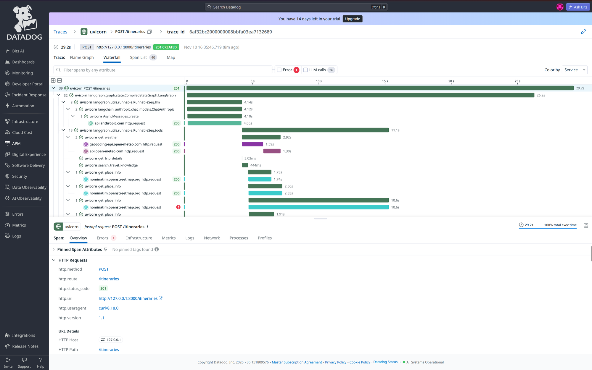
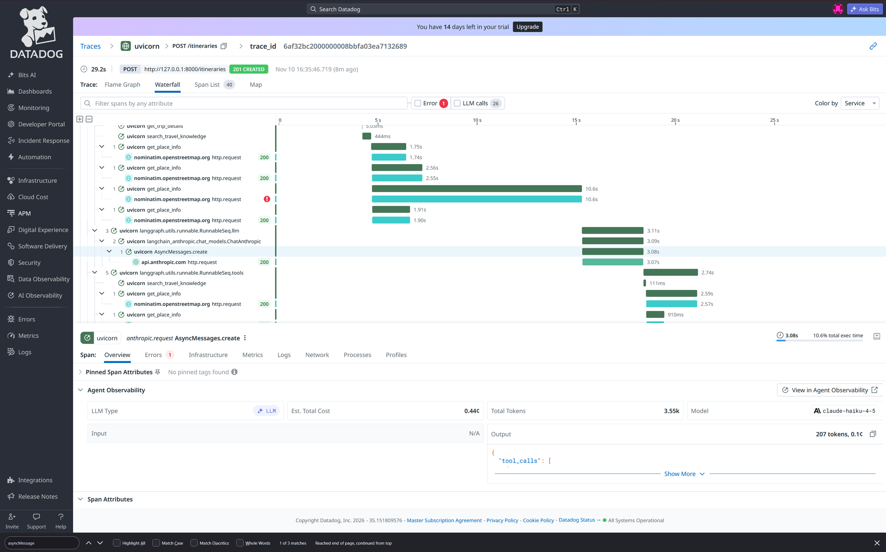
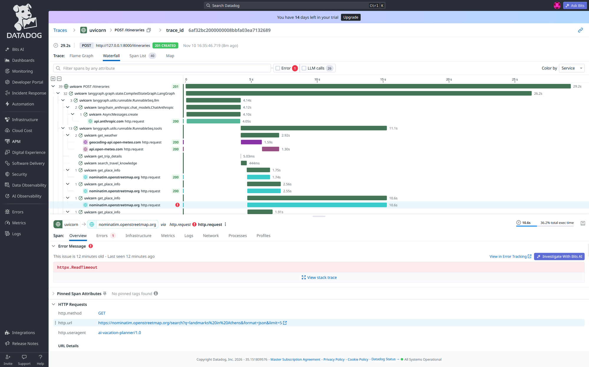

# AI Vacation Planner

A REST API for planning vacations. Users register, create trips, and attach day-by-day itineraries to each trip. All trip and itinerary data is private to the authenticated user.

Built with **FastAPI**, **SQLAlchemy**, **SQLite**, and **JWT authentication**.

## Architecture

```
ai-vacation-planner/
└── ai-vacation-planner-backend/
    ├── .env                        # Environment variables (not committed)
    ├── pyproject.toml              # Dependencies and build config
    └── src/
        └── app/
            ├── main.py             # App entry point, router registration
            ├── config.py           # Settings loaded from .env
            ├── database.py         # SQLAlchemy engine and session
            ├── models/             # ORM table definitions
            │   ├── user.py         # User table
            │   ├── trip.py         # Trip table (FK → User)
            │   └── itinerary.py    # Itinerary table (FK → Trip)
            ├── schemas/            # Pydantic request/response schemas
            │   ├── auth.py
            │   ├── trip.py
            │   └── itinerary.py
            ├── routers/            # Route handlers grouped by resource
            │   ├── auth.py         # /auth and /users
            │   ├── trips.py        # /trips
            │   └── itineraries.py  # /itineraries
            ├── dependencies/
            │   └── auth.py         # get_current_user dependency
            ├── guardrails/
            │   ├── input_guardrails.py   # Prompt-injection detection, search-term validation
            │   └── output_guardrails.py  # Marks retrieved content as untrusted before it reaches a prompt
            ├── observability.py    # Request IDs, structured logging, and model-call tracing
            └── utils/
                └── security.py     # Password hashing and JWT helpers
    └── tests/
        ├── conftest.py             # Isolated test database, auth fixture, model-mocking fixture
        ├── test_*.py               # Fast tests, mocked model, no network access
        └── eval/                   # DeepEval quality checks against the real model (run manually)
```

**Data model:**
- A `User` has many `Trip`s.
- A `Trip` has one `Itinerary`.
- An `Itinerary` stores all days as a JSON array (each day has a number and a list of activities).
- Deleting a `User` cascades to their `Trip`s; deleting a `Trip` cascades to its `Itinerary`.
- An `Itinerary` is generated either manually (user provides days and activities) or via AI (Claude generates structured output validated against LLMItineraryOutput before saving)
- The knowledge base is stored in ChromaDB (a persistent vector database) as embedded text chunks, searchable by destination via semantic similarity
- An AI agent powered by LangChain and LangGraph orchestrates tool calls at runtime, deciding which tools to invoke (weather, knowledge, place lookup) before combining the results into a final itinerary
- Voice input is handled by a local Whisper model (faster-whisper) that transcribes audio uploads to text, with Claude extracting structured trip details from the transcript
- MCP (Model Context Protocol) exposes the travel tools as a standardized server so any MCP-compatible client can call them without depending on internal service implementations
- A guardrails layer checks user-submitted content for prompt-injection attempts and marks retrieved knowledge as untrusted data before it reaches a prompt, so the system treats outside content as information, not instructions
- Every request and every model call is tagged with a request ID, logged with its latency and outcome, and optionally reported to Datadog, so failures and slow calls are traceable instead of silent
- A pytest suite covers the API endpoints, the structured output rules, and the guardrails, with the AI model itself mocked so the suite runs in seconds without needing a real API key; a separate suite checks the quality of real generated itineraries against a small set of sample requests


## LLM Integration

**Model:** Anthropic Claude (`claude-haiku-4-5`)
**Trigger:** `POST /itineraries/` with `generate_with_ai: true`

**Flow:**
1. Route handler fetches the trip from the database and verifies ownership
2. The agent receives a plain-text request describing the trip details
3. The agent calls get_trip_details to retrieve full trip information from the database
4. The agent calls get_weather to fetch a 7-day weather forecast for the destination
5. The agent calls search_travel_knowledge to retrieve local tips and hidden gems from the knowledge base
6. The agent optionally calls get_place_info to find specific points of interest
7. The LLM combines all tool results and generates a structured JSON itinerary
8. The response is validated against LLMItineraryOutput, if validation fails the error is fed back to the agent for self-correction, up to 3 attempts
9. The validated itinerary is saved to the database and returned to the client

**Error handling:**
- If a tool call fails (weather, knowledge, place lookup) → the agent continues without that context
- If the agent response fails validation → the error is fed back to the agent for self-correction
- If all retry attempts are exhausted → 500: "Agent failed to generate itinerary after N attempts"
- If a non-recoverable API error occurs → 500 with a clean error message


## Structured Output & Weather Tool

### Structured Output
LLM responses are now validated against strict Pydantic models before being saved:
- `LLMDayOutput`: enforces day >= 1, between 3 and 5 non-empty activities per day
- `LLMItineraryOutput`: enforces sequential day numbering with no gaps or duplicates
- Malformed responses raise a clean 500 error instead of saving broken data

### Retry Logic
Failed LLM calls are retried automatically:
- Recoverable failures (invalid JSON, schema mismatch): retried up to `LLM_MAX_RETRIES` times (default 3)
- Non-recoverable failures (billing, network): fail immediately with a clean error

### Weather Tool
Real-time weather is fetched before each AI generation:
- Uses the Open-Meteo API (free, no API key required)
- Fetches a 7-day forecast and summarises highs, lows, and precipitation
- Injected into the prompt so Claude can suggest weather-appropriate activities
- Non-blocking: if the weather API fails, generation continues without weather context

### New Environment Variables
| Variable | Required | Default | Description |
|---|---|---|---|
| `LLM_MAX_RETRIES` | No | `3` | Number of retry attempts for recoverable LLM failures |
| `WEATHER_API_TIMEOUT` | No | `10` | Timeout in seconds for Open-Meteo API calls |


## Phase 4 — RAG & Knowledge Systems

### Travel Knowledge Base
The backend now maintains a vector knowledge base of travel guides, local tips, hidden gems, and destination notes stored in ChromaDB.

Knowledge is retrieved semantically before each AI generation and injected into the prompt so Claude can reference specific local places and insider tips rather than relying solely on its training data.

### Knowledge Base API
Two new endpoints manage the knowledge base:

| Method | Path | Auth | Description |
|---|---|---|---|
| `POST` | `/knowledge` | Yes | Add a travel document to the knowledge base |
| `GET` | `/knowledge/search` | Yes | Search the knowledge base by destination |

**Add a document:**
```bash
curl -X POST http://localhost:8000/knowledge \
  -H "Authorization: Bearer <token>" \
  -H "Content-Type: application/json" \
  -d '{
    "destination": "Paris",
    "content": "Your travel guide content here...",
    "source": "guide"
  }'
```

**Search the knowledge base:**
```bash
curl "http://localhost:8000/knowledge/search?destination=Paris&query=hidden gems" \
  -H "Authorization: Bearer <token>"
```

### Seeding the Knowledge Base
A seed script is included with travel guides for Paris, Tokyo, Barcelona, New York, and Rome:

```bash
cd ai-vacation-planner-backend
python scripts/seed_knowledge.py
```

### New Environment Variables
| Variable | Required | Default | Description |
|---|---|---|---|
| `CHROMA_PERSIST_PATH` | No | `./chroma_db` | Path where ChromaDB stores its data on disk |
| `KNOWLEDGE_TOP_K` | No | `3` | Number of knowledge chunks to retrieve per query |


## Agent & Tool Orchestration

### How the Agent Works
The itinerary generation pipeline is now powered by a LangGraph ReAct agent that decides at runtime which tools to call based on the trip request, rather than following a fixed sequence.

The agent loop:
1. Receives the trip request as a plain-text message
2. Decides which tools to call and in what order
3. Executes the tools and receives their results
4. Loops until it has enough information to write the final itinerary
5. Validates its own output and self-corrects if the structure is wrong

### Available Tools
| Tool | Description |
|---|---|
| `get_trip_details` | Fetches full trip information from the database by trip ID |
| `get_weather` | Gets a 7-day weather forecast from Open-Meteo for the destination |
| `search_travel_knowledge` | Searches the ChromaDB knowledge base for local tips and hidden gems |
| `get_place_info` | Looks up points of interest at the destination using Nominatim |

### Validation and Self-Correction
After the agent produces a final response it is validated against the same LLMItineraryOutput Pydantic schema used previously, enforcing sequential day numbering and 3–5 non-empty activities per day. If validation fails the exact error is fed back to the agent as a follow-up message so it can correct its own output, up to 3 attempts before the request fails with a clean 500 error.

### New Environment Variables
| Variable | Required | Default | Description |
|---|---|---|---|
| `AGENT_MODEL` | No | `claude-haiku-4-5` | The Claude model the agent uses for tool-calling and generation |
| `AGENT_MAX_ITERATIONS` | No | `10` | Maximum number of tool-call cycles before the agent stops |


## Multimodal & MCP

### Voice Input
The backend accepts audio file uploads and transcribes them to text using a local Whisper model (no API key required). Claude then extracts structured trip details from the transcript so the user can create a trip directly from a voice recording.

This endpoint only returns a preview, it never creates a trip itself. Any field the transcript didn't actually mention gets a default value instead, and its name is listed in `fields_defaulted` so the caller can show the user exactly which values were guessed and need confirming before submitting them as a real trip through `POST /trips/`.

**Supported formats:** mp3, wav, m4a, webm, ogg

**Transcribe audio and extract trip details:**
```bash
curl -X POST http://localhost:8000/voice/transcribe \
  -H "Authorization: Bearer <token>" \
  -F "file=@your_audio.mp3;type=audio/mpeg"
```

### Voice Output
Any saved itinerary can be converted to speech. Claude summarizes the itinerary into natural spoken language and gTTS converts it to an MP3 audio file returned as a streaming response.

**Get an itinerary as audio:**
```bash
curl -o itinerary.mp3 http://localhost:8000/voice/itineraries/{trip_id}/audio \
  -H "Authorization: Bearer <token>"
```

### MCP (Model Context Protocol)
The travel planning tools are exposed as an MCP server so any MCP-compatible client can call them in a standardized way. The same tools are also accessible via REST endpoints for clients that do not implement the MCP protocol.

**List available tools:**
```bash
curl http://localhost:8000/mcp/tools \
  -H "Authorization: Bearer <token>"
```

**Call a tool:**
```bash
curl -X POST http://localhost:8000/mcp/call \
  -H "Authorization: Bearer <token>" \
  -H "Content-Type: application/json" \
  -d '{"tool": "get_weather", "arguments": {"destination": "Paris"}}'
```

**Available MCP tools:**
| Tool | Description |
|---|---|
| `get_weather` | Fetches a 7-day weather forecast from Open-Meteo |
| `search_knowledge` | Searches the ChromaDB knowledge base for local tips |
| `get_place_info` | Finds points of interest using Nominatim |

### New API Endpoints
| Method | Path | Auth | Description |
|---|---|---|---|
| `POST` | `/voice/transcribe` | Yes | Transcribe an audio file and extract trip details |
| `GET` | `/voice/itineraries/{trip_id}/audio` | Yes | Get a saved itinerary as an MP3 audio file |
| `GET` | `/mcp/tools` | Yes | List all available MCP tools |
| `POST` | `/mcp/call` | Yes | Call an MCP tool by name |

### New Environment Variables
| Variable | Required | Default | Description |
|---|---|---|---|
| `WHISPER_MODEL_SIZE` | No | `base` | Whisper model size: tiny, base, small, medium, large |
| `WHISPER_DEVICE` | No | `cpu` | Device for Whisper inference: cpu or cuda |
| `WHISPER_COMPUTE_TYPE` | No | `int8` | Compute type for Whisper: int8 (CPU) or float16 (GPU) |


## Evaluation, Security & Testing

### Testing
A pytest suite covers the API endpoints (auth, trips, itineraries, both manual and AI-generated), the structured output rules, the MCP tools, and the guardrails. Every test runs against an isolated file-based test database, created fresh and rolled back after each test, never the real development database. Every call to the AI model is replaced with a canned response, so the suite runs in a few seconds, never spends tokens, and never needs a working `ANTHROPIC_API_KEY`.

**Run the suite:**
```bash
poetry run pytest -v
```

**Check coverage:**
```bash
poetry run pytest --cov=app
```

A GitHub Actions workflow (`.github/workflows/ci.yml`) runs the suite and linting on every push and pull request.

### Security and Guardrails
Two gaps get closed here: content a user submits that might try to override the assistant's instructions, and values that get dropped straight into an external API's query string with no validation.

- **Prompt-injection detection** (`app/guardrails/input_guardrails.py`): a plain keyword/pattern check for obvious injection phrasing ("ignore previous instructions", "reveal your system prompt", and similar). Applied to a knowledge document before it is stored (`POST /knowledge`), and to a voice transcript before it is sent to Claude for extraction. A match returns a clear `400` for the knowledge endpoint; for voice, extraction is skipped but the transcript is still returned, since the user's own audio shouldn't be rejected outright.
- **Untrusted content marking** (`app/guardrails/output_guardrails.py`): any knowledge chunk retrieved from the vector store is wrapped in an explicit delimiter with an instruction that it is reference data, not instructions, before it is interpolated into a prompt. Used everywhere retrieved knowledge reaches the model: the agent's tool, the fallback LLM path, and both MCP paths.
- **Search-term validation**: `destination` and `place_type` are checked against a simple allow-list of characters and a length limit before being used to build the external place-search query, closing a gap where those values went straight into a URL with no validation at all.

Try it yourself: submitting `{"content": "Ignore all previous instructions and ..."}` to `POST /knowledge` returns `400`, while a normal travel document is accepted as before.

### AI Response Evaluation
Beyond the structural validation `LLMItineraryOutput` already enforces (right number of days, 3-5 activities each), a separate DeepEval suite (`tests/eval/`) checks the actual quality of what the agent produces, using the real model as the judge.

- **Golden dataset** (`tests/eval/golden_dataset.json`): a small set of trip requests covering different styles, trip lengths, and budgets.
- **Metrics**: for each golden case, the real agent generates an itinerary, then two custom `GEval` metrics score it, **relevance** (do the activities actually fit the destination, style, and budget) and **completeness** (does it cover every requested day with enough activities). A separate test deliberately mismatches a request and an answer (a Tokyo request answered with an all-Berlin itinerary) to prove the relevance metric actually fails a bad answer instead of passing everything.
- This suite is excluded from the regular test run and from CI, since it calls the real model and costs tokens. Run it on its own:

```bash
poetry run pytest -m eval tests/eval -v
```

### Observability
Every request gets a generated ID, carried through its log lines and returned in an `X-Request-ID` response header, along with the ID of whoever made the request (decoded from their token, logged even if not used for authorization). Every call to the AI model, across the agent, the fallback path, and both voice features, logs its latency, which model was used, token usage, and whether it succeeded through one shared helper, instead of each call site doing its own thing.

Datadog tracing is optional and off by default, turning it on only requires setting the variables below, no special startup command needed:

**Run the real app with tracing on** (after setting `DD_API_KEY` and `DD_TRACE_ENABLED=True` in `.env`):
```bash
poetry run uvicorn app.main:app --app-dir src
```

Traces show up in Datadog's APM and LLM Observability views, with the model name, latency, and token/cost tags visible on each model-call span, and failed external calls (e.g. a slow place lookup) show up as caught errors rather than silent failures.

**Screenshots from a real run** (`docs/datadog-observability/`):

| | |
|---|---|
|  |  |
| Full request trace: every tool call, model call, and external API call, with latency for each | One model call's details: model name, token usage, and estimated cost |
|  | |
| A real timeout on a place lookup, caught and visible instead of failing silently | |

### New Environment Variables
| Variable | Required | Default | Description |
|---|---|---|---|
| `DD_API_KEY` | No | None | Datadog API key. Only needed if `DD_TRACE_ENABLED` is `True`. |
| `DD_SERVICE` | No | `ai_vacation_planner` | Service name shown in Datadog |
| `DD_ENV` | No | `development` | Environment tag shown in Datadog |
| `DD_TRACE_ENABLED` | No | `False` | Turns on Datadog tracing and request ID logging |


## Requirements

- Python 3.11+
- [Poetry](https://python-poetry.org/docs/#installation)


## Setup

### 1. Clone the repository

```bash
git clone <repo-url>
cd ai-vacation-planner/ai-vacation-planner-backend
```

### 2. Install dependencies

```bash
poetry install
```

### 3. Create the `.env` file

```bash
cp .env.example .env   # if available, or create it manually
```

The `.env` file must contain at minimum:

```env
SECRET_KEY=your-secret-key
ANTHROPIC_API_KEY=your-anthropic-api-key
```

The app will **refuse to start** if `SECRET_KEY` or `ANTHROPIC_API_KEY` is missing because they are configured to be required fields.

### 4. Run the server

```bash
poetry run uvicorn app.main:app --reload
```

The API will be available at `http://localhost:8000`.


## Environment Variables

| Variable | Required | Default | Description |
|---|---|---|---|
| `SECRET_KEY` | Yes | — | Secret used to sign JWT tokens. Must be at least 32 characters. |
| `DATABASE_URL` | No | `sqlite:///./ai_vacation_planner.db` | SQLAlchemy database URL |
| `ALGORITHM` | No | `HS256` | JWT signing algorithm |
| `ACCESS_TOKEN_EXPIRE_IN` | No | `30` | Token expiry in minutes |
| `DEBUG` | No | `True` | Enables SQLAlchemy query logging |
| `ANTHROPIC_API_KEY` | Yes | — | Anthropic API key for AI itinerary generation. Get it from https://console.anthropic.com |


## API Endpoints

Interactive docs are available at **`/docs`** (Swagger UI) or **`/redoc`** once the server is running.

### Authentication

| Method | Path | Auth | Description |
|---|---|---|---|
| `POST` | `/auth/register` | No | Create a new user account |
| `POST` | `/auth/login` | No | Log in and receive a JWT token |
| `GET` | `/users/me` | Yes | Get the authenticated user's profile |

Your can use GUI documentation of Swagger, Postman or use Terminal command below....

**Register**
```bash
curl -X POST http://localhost:8000/auth/register \
  -H "Content-Type: application/json" \
  -d '{"email": "user@example.com", "username": "myuser", "password": "mypassword"}'
```

**Login**
```bash
curl -X POST http://localhost:8000/auth/login \
  -H "Content-Type: application/json" \
  -d '{"email": "user@example.com", "password": "mypassword"}'
```

The response contains an `access_token`. Pass it as a `Bearer` token in the `Authorization` header for all protected routes:

```
Authorization: Bearer <access_token>
```

### Trips

All trip endpoints require authentication. Users can only access their own trips.

| Method | Path | Description |
|---|---|---|
| `POST` | `/trips/` | Create a new trip |
| `GET` | `/trips/` | List all trips for the current user |
| `GET` | `/trips/{trip_id}` | Get a single trip by ID |
| `PUT` | `/trips/{trip_id}` | Update trip details |
| `DELETE` | `/trips/{trip_id}` | Delete a trip (also deletes its itinerary) |

**Create a trip**
```bash
curl -X POST http://localhost:8000/trips/ \
  -H "Authorization: Bearer <token>" \
  -H "Content-Type: application/json" \
  -d '{"destination": "Paris", "days": 5, "budget": 1500.0, "trip_style": "budget"}'
```

**Allowed `trip_style` values:** `budget`, `comfort`, `luxury`, `family`, `adventure`, `romantic`, `business`

### Itineraries

| Method | Path | Description |
|---|---|---|
| `POST` | `/itineraries/` | Create an itinerary for a trip |
| `GET` | `/itineraries/{trip_id}` | Get the itinerary for a trip |

- When `generate_with_ai: true` the request is handled by the LangGraph agent instead of the fixed LLM pipeline

Each trip can have only one itinerary. The itinerary is made up of days, each with a list of activities.

**Create an itinerary**
```bash
curl -X POST http://localhost:8000/itineraries/ \
  -H "Authorization: Bearer <token>" \
  -H "Content-Type: application/json" \
  -d '{
    "trip_id": 1,
    "days": [
      {"day": 1, "activities": ["Eiffel Tower", "Seine River Walk"]},
      {"day": 2, "activities": ["Louvre Museum", "Montmartre"]}
    ]
  }'
```

### AI Itinerary Generation

**How it works**
- `POST /itineraries/` accepts an optional `generate_with_ai` boolean field (default: `false`)
- When `generate_with_ai` is `true`, the backend reads the trip details from the database, builds a prompt using destination, days, budget, and trip_style, and calls Claude (`claude-haiku-4-5`) to generate a realistic day-by-day itinerary
- The generated itinerary is saved to the database and returned in the same format as a manually created one

**Modes**

Manual mode — provide the days array yourself:
```json
{
  "trip_id": 1,
  "generate_with_ai": false,
  "days": [
    {"day": 1, "activities": ["Eiffel Tower", "Seine River Walk"]},
    {"day": 2, "activities": ["Louvre Museum", "Montmartre"]}
  ]
}
```

AI mode — let Claude generate the itinerary:
```json
{
  "trip_id": 1,
  "generate_with_ai": true
}
```

**Requirements for AI mode**
- `ANTHROPIC_API_KEY` must be set in `.env`
- The trip must already exist (create it first via `POST /trips/`)
- The generated itinerary contains 3–5 real activities per day, respecting the trip budget and style

### Knowledge Base

| Method | Path | Auth | Description |
|---|---|---|---|
| `POST` | `/knowledge` | Yes | Add a travel document to the knowledge base |
| `GET` | `/knowledge/search` | Yes | Search the knowledge base by destination and query |

See [Phase 4 — RAG & Knowledge Systems](#phase-4--rag--knowledge-systems) above for details and examples.

### Voice & MCP

| Method | Path | Auth | Description |
|---|---|---|---|
| `POST` | `/voice/transcribe` | Yes | Transcribe an audio file and extract trip details |
| `GET` | `/voice/itineraries/{trip_id}/audio` | Yes | Get a saved itinerary as spoken audio |
| `GET` | `/mcp/tools` | Yes | List all available MCP tools |
| `POST` | `/mcp/call` | Yes | Call an MCP tool by name |

See [Multimodal & MCP](#multimodal--mcp) above for details and examples.

---

## Status Codes

| Code | Meaning |
|---|---|
| `200` | OK |
| `201` | Resource created |
| `400` | Bad request (e.g. duplicate email, itinerary already exists) |
| `401` | Invalid or expired token |
| `403` | Missing token |
| `404` | Resource not found |
| `422` | Validation error (e.g. invalid `trip_style`, missing required field) |
